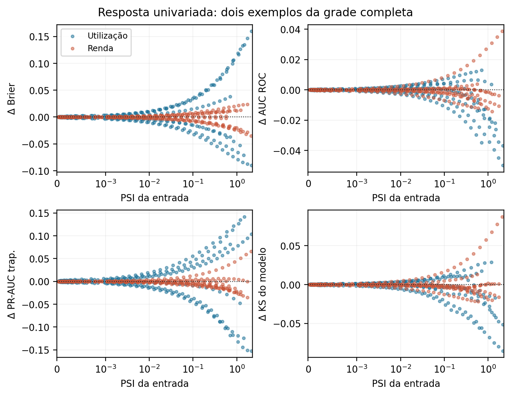
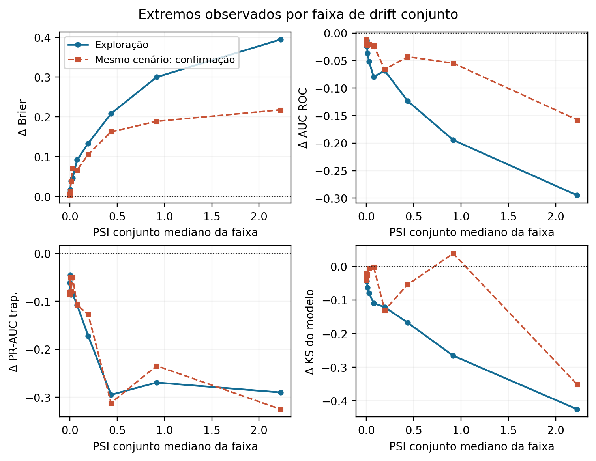
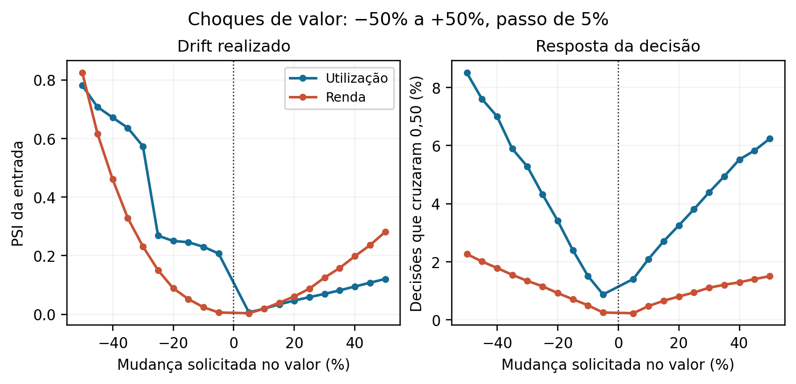
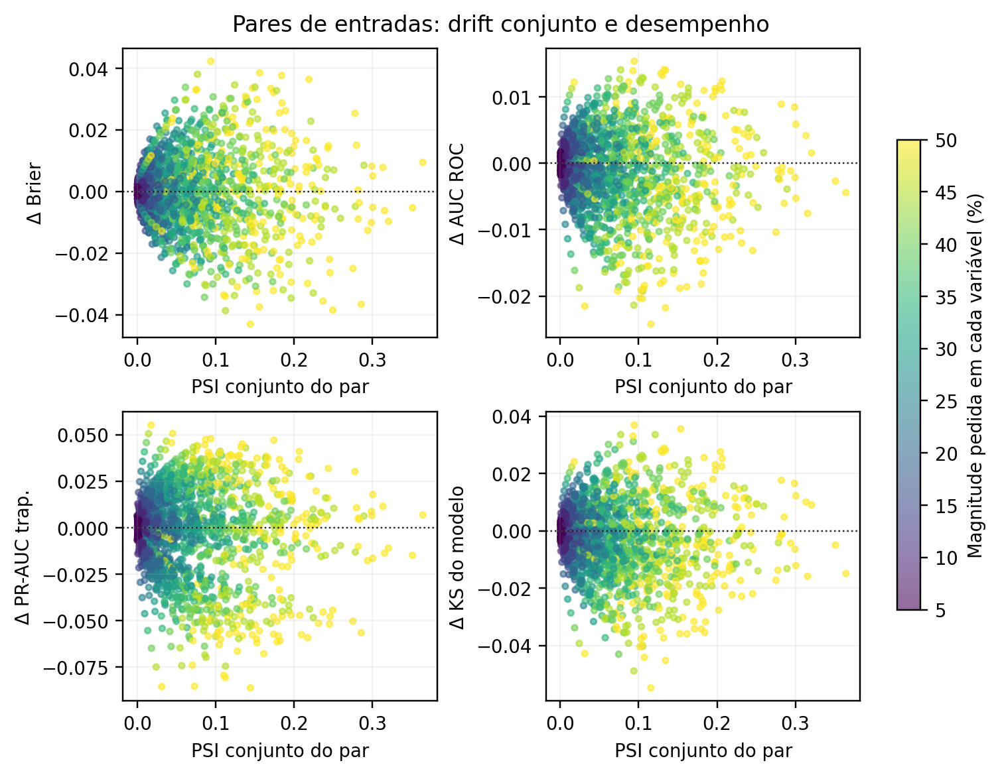

# Atlas didático de testes de estresse e drift para um modelo de crédito

**Brier, AUC ROC, PR-AUC trapezoidal e KS do modelo · 27 de setembro de 2026**

Este relatório acompanha os notebooks da pasta `notebooks/` deste repositório. O objetivo é aprender a construir cenários, medir o drift realmente produzido e relacioná-lo à resposta de um classificador de crédito. O material apresenta **curvas de resposta**, magnitudes e incerteza; não impõe um ponto de aprovação ou reprovação ao modelo. A seção 11 ensina a reproduzir o estudo em uma máquina nova. O arquivo `README.md` na raiz do projeto é a porta de entrada para instalação, organização dos arquivos e sequência de execução.

## 1. Resposta à pergunta central

**“Quanto drift o modelo tolera?” precisa de duas partes.** A primeira é empírica: para cada mecanismo, variável, direção e intensidade, medir o drift observado e a mudança das métricas. Esta parte está nos notebooks e CSVs. A segunda é uma decisão de risco: escolher qual queda de AUC, PR-AUC ou KS, ou qual aumento de Brier, é aceitável para o uso concreto do modelo. Como o estudo não recebeu tal limite, **não há um número único de PSI que possa ser chamado de tolerância aprovada**. Declarar uma “primeira falha” com um corte inventado daria precisão aparente a uma escolha subjetiva.

O resultado utilizável agora é uma função de resposta. Por exemplo, uma trajetória pode ser lida como “quando a participação de determinado perfil muda 5%, 10%, ..., 50%, o PSI desta variável é `x` e as diferenças de Brier, AUC, PR-AUC e KS são `d`”. Compare também direções opostas, medidas de suporte e intervalos de incerteza. Quando houver limites de negócio e uma amostra temporal rotulada, a mesma curva permite localizar a região de investigação; não é necessário refazer os cenários.

**Quatro cuidados dominam a interpretação.** (1) O PSI mede diferença de distribuição, não perda de desempenho; a mesma distância pode ter efeitos distintos conforme a região de risco. (2) Reponderar linhas históricas completas permite métricas com rótulos reais sob uma hipótese de mudança de composição; alterar o valor econômico real de uma pessoa cria um desfecho contrafactual não observado. (3) `cs-test.csv` não possui rótulos e só informa drift de entradas, score, decisão e operação. (4) O modelo desta suíte é um **retreino** auditável com `scale_pos_weight=13.882494684620836`; ele não é o objeto original `model_class` serializado, que não foi disponibilizado.

## 2. Base, modelo e protocolo de avaliação

Os arquivos `data/raw/cs-training.csv` e `data/raw/cs-test.csv` são insumos locais. O primeiro contém 150.000 registros com o alvo `SeriousDlqin2yrs`; o segundo contém 101.503 registros sem alvo observado. A pasta `data/raw/` é ignorada pelo Git, portanto quem clonar o projeto precisa fornecer esses arquivos. O índice `Unnamed: 0` é descartado. A sequência de divisão reproduzida de `reference/model_final.ipynb` usa primeiro 15% para holdout (`random_state=33`) e depois 17,65% do restante para validação. Resultam 104.996 observações de treino, 22.504 de validação e 22.500 de holdout. A divisão é aleatória, **não temporal**. O Booster em `models/` foi retreinado com os parâmetros documentados no manifesto, incluindo `scale_pos_weight=13.882494684620836`; o corte de decisão permanece 0,50. `n_estimators=800` era o limite solicitado, mas o treino com parada antecipada armazenou **103 rodadas** e registrou `best_iteration=72`. Os testes predizem com todas as 103 rodadas armazenadas, como a política do manifesto e o notebook original. O manifesto registra hash, versões, ordem das dez variáveis e política de predição.

| Métrica no holdout rotulado | Valor basal | Leitura |
|---|---:|---|
| AUC ROC | 0,866840 | Ordenação entre eventos e não eventos. |
| PR-AUC trapezoidal | 0,395991 | Área interpolada sob precisão versus recall. |
| AP, medida adicional | 0,396385 | Soma dos degraus de precisão; não é a PR-AUC acima. |
| KS do modelo | 0,587714 | Maior distância vertical entre TPR e FPR ao variar o corte. |
| Brier | 0,144038 | Erro quadrático médio do score; menor é melhor. |
| Recall no corte 0,50 | 0,794000 | Referência descritiva de decisão. |
| Precisão no corte 0,50 | 0,215254 | Referência descritiva de decisão. |

O Brier do preditor constante na prevalência do holdout (6,67%) é aproximadamente 0,06222, inferior ao Brier do Booster. O treino com forte peso positivo deslocou os scores; **não trate o score bruto como probabilidade de inadimplência calibrada** sem uma avaliação/calibração separada. A AUC pode continuar boa enquanto a calibração é ruim. O corte 0,50 é uma política fixa solicitada para os testes, não uma recomendação econômica.

As entradas, na ordem do Booster, são `RevolvingUtilizationOfUnsecuredLines`, `age`, `NumberOfTime30-59DaysPastDueNotWorse`, `DebtRatio`, `MonthlyIncome`, `NumberOfOpenCreditLinesAndLoans`, `NumberOfTimes90DaysLate`, `NumberRealEstateLoansOrLines`, `NumberOfTime60-89DaysPastDueNotWorse` e `NumberOfDependents`.

## 3. Dicionário de conceitos

| Conceito | Definição operacional neste estudo |
|---|---|
| Entrada `X` | Vetor das dez variáveis conhecidas no momento da predição. `X_j` é uma variável. |
| Rótulo `Y` | Desfecho observado, 1 para inadimplência conforme o alvo do CSV, 0 caso contrário. |
| Score `p` | Saída do Booster `binary:logistic`; não foi demonstrado que seja PD calibrada. |
| Holdout | Amostra rotulada separada antes de ajustar árvores; aqui é fora da amostra, não fora do tempo. |
| Drift marginal | Mudança da distribuição de uma única entrada. |
| Drift conjunto | Mudança de combinações ou dependências de duas ou mais entradas. |
| Drift de score | Mudança da distribuição de saídas do modelo. |
| Covariate shift | Mudança em `P(X)` com hipótese adicional de estabilidade do risco condicional `P(Y dado X)`. |
| Ruptura condicional | Mudança no risco condicional `P(Y dado X)`; pode ocorrer com `P(X)` constante. |
| Composição ou mix | Frequência relativa de perfis históricos completos `(X,Y)`; é alterada por pesos de linha. |
| Contrafactual | Valor ou desfecho que não foi observado para a mesma pessoa sob outra condição. |
| Cenário | Regra explícita que define mecanismo, direção, intensidade e população afetada. |
| Intensidade pedida | Controle do gerador, por exemplo `+10%`; não é PSI nem necessariamente mudança efetiva. |
| Intensidade realizada | Alteração efetiva após zeros, arredondamento, truncamento e suporte. |
| Suporte | Conjunto de perfis representados pelos dados históricos; pesos concentrados enfraquecem inferência. |
| Calibração | Concordância entre score e frequência observada de evento. |
| Discriminação | Capacidade de ordenar eventos acima de não eventos. |
| Bootstrap pareado | Reamostrar os mesmos clientes para as métricas basal e estressada e estimar a distribuição da diferença. |
| PSI | Soma de diferenças de proporção entre bins fixos ponderadas pelo log da razão; é adimensional e não é porcentagem. |
| KS de drift | Maior distância absoluta entre duas distribuições acumuladas de uma variável. |
| KS do modelo | Maior diferença `TPR−FPR` entre classes ao variar o limiar do score. |
| W1 | Distância Wasserstein de ordem 1, na unidade da variável antes de normalizar. |
| ESS | Tamanho efetivo da amostra após reponderação. |
| AP | *Average precision*, área por degraus da curva precisão–recall. |
| PR-AUC trapezoidal | Integração por trapézios da curva precisão–recall; pode diferir de AP. |

### 3.1 Siglas

| Sigla | Nome | Interpretação |
|---|---|---|
| AUC ROC | Area under receiver operating characteristic curve | Área sob TPR versus FPR. |
| PR-AUC | Area under precision–recall curve | Aqui, explicitamente integração trapezoidal. |
| AP | Average precision | Integração por degraus; métrica adicional. |
| BSS | Brier skill score | Comparação do Brier com preditor de referência; não é a métrica central. |
| DRO | Distributionally robust optimization | Busca adversarial em uma família de pesos de grupos. |
| ESS | Effective sample size | Massa informativa aproximada sob pesos. |
| FPR | False positive rate | Fração de não eventos com decisão positiva. |
| KS | Kolmogorov–Smirnov | Neste estudo aparece como KS do modelo ou KS de drift; ver a coluna de definição. |
| OOS / OoT | Out of sample / out of time | Nosso holdout é OOS e não OoT. |
| PD | Probability of default | Requer horizonte e calibração compatíveis com o uso. |
| PSI | Population stability index | Divergência entre proporções em bins fixos. |
| TPR | True positive rate | Sinônimo de recall. |
| W1 | Wasserstein-1 | Distância entre distribuições numéricas. |

## 4. Fórmulas: como calcular e como ler cada símbolo

### 4.1 Brier, AUC, PR-AUC e KS do modelo

Para `n` observações rotuladas, `y_i∈{0,1}` é o rótulo e `p_i∈[0,1]` o score. **Brier** é `Σ_i(y_i−p_i)^2/n`. Menor é melhor; ele combina qualidade do score e discriminação, mas um valor isolado não prova calibração. Se a população é reponderada, usamos `Σ_i w_i(y_i−p_i)^2 / Σ_i w_i`, onde `w_i≥0` é o peso do caso `i`. A comparação basal versus cenário deve usar o mesmo conjunto de casos e política de predição.

Em um limiar `t`, `TPR(t)=TP/(TP+FN)` e `FPR(t)=FP/(FP+TN)`; `TP`, `FN`, `FP` e `TN` são os quatro totais da matriz de confusão. **AUC ROC** integra TPR em relação a FPR quando `t` percorre todos os scores. Também equivale à probabilidade de um evento ter score maior que um não evento, com meio crédito para empate. **KS do modelo** é `max_t[TPR(t)−FPR(t)]`. Ele deve ser calculado em todos os limiares relevantes, com tratamento de empates, e não só no corte 0,50. A implementação usa `roc_curve(..., drop_intermediate=False)` ou fórmula vetorizada equivalente.

**Precisão(t)=TP/(TP+FP)** e **recall(t)=TPR(t)**. A PR-AUC desta variante é a **área trapezoidal** `Σ_k (R_k−R_{k−1})(P_k+P_{k−1})/2`, com pontos ordenados por recall crescente; `R_k` é recall e `P_k` é precisão no ponto `k`. Em Python: `precision_recall_curve` seguido de `auc(recall, precision)`. A **AP** é `Σ_k (R_k−R_{k−1})P_k`, usando os degraus em vez da interpolação linear. As definições podem fornecer valores diferentes; por isso os CSVs e gráficos as nomeiam separadamente. A [documentação oficial do scikit-learn para AP](https://scikit-learn.org/stable/modules/generated/sklearn.metrics.average_precision_score.html) explicita a diferença e alerta que a interpolação trapezoidal pode ser otimista.

No corte fixo `c=0,50`, `d_i=1[p_i≥c]`. **Recall** e **precisão** nesse corte ajudam a entender a decisão. Eles não são regra de parada, nem selecionam cenário “aprovado”. A PR-AUC e a precisão também dependem da prevalência; compare-as juntamente com a prevalência ponderada em choques de mix.

### 4.2 PSI, KS de drift, W1 e percentual

Congele `B` bins na referência. `r_b` é a proporção da referência no bin `b`; `q_b` a proporção do cenário. Com pequena suavização `ε` documentada para bins vazios, `PSI=Σ_b(q_b−r_b) ln[(q_b+ε)/(r_b+ε)]`. `Σ_b` soma os bins e `ln` é logaritmo natural. PSI zero significa proporções idênticas **na resolução desses bins**. Ele pode não perceber alterações dentro de uma faixa e não equivale a 0%, 5% ou 10%. A regra de bins, o tratamento de zero e ausentes e o tamanho da janela precisam acompanhar cada número de PSI.

`KS_drift=sup_x |F_cenário(x)−F_referência(x)|`, onde `F` é distribuição acumulada e `sup_x` indica o maior valor em todos os `x`. Esse KS compara **duas populações de uma entrada**; não é o KS do modelo acima. `W1=∫|F_cenário(x)−F_referência(x)|dx` em uma dimensão; `dx` é a unidade da entrada. A versão normalizada divide por uma escala da referência, declarada no notebook.

Para uma mudança de **valor**, `x'_i=x_i(1+r)` e `r` é o percentual assinado, de −0,50 a +0,50 em passos de 0,05. Contagens requerem arredondamento e restrições de domínio; se `x'_i=x_i` para todos, o choque **não realizou drift**, mesmo que `r≠0`. Para uma mudança de **participação**, um grupo com proporção basal `q` passa a `q'=q(1+r)` quando isso é factível; pesos de linha realizam o novo mix. O percentual pedido e o PSI resultante são objetos diferentes. Na grade de dois atributos, cada direção (`++`, `+-`, `-+`, `--`) é um mecanismo distinto.

### 4.3 Pesos, suporte e incerteza

Para pesos de composição `w_i`, `ESS=(Σ_i w_i)^2/Σ_i w_i²`. Se todos são iguais, ESS=`n`; quando poucos casos dominam, ESS diminui. A prevalência ponderada é `Σ_i w_i y_i/Σ_i w_i`. Mudança de mix só autoriza inferir desempenho do alvo se existe sobreposição de suporte e `P_alvo(Y|X)=P_histórico(Y|X)` é uma aproximação defensável. AUC ou Brier ponderado **não** é desempenho observado de `cs-test`.

O efeito do cenário é `ΔM=M_cenário−M_basal`; `M` pode ser uma das quatro métricas centrais. Queda de AUC, PR-AUC ou KS e aumento de Brier são movimentos desfavoráveis. Uma melhora em uma e piora em outra deve ser mostrada, não comprimida em “passou/falhou”. O bootstrap pareado sorteia índices `i` e recalcula `ΔM` basal e estressado nas **mesmas** réplicas. Intervalos de 95% são percentis empíricos das diferenças; quando o cenário extremo é escolhido dentre milhares pelo próprio holdout, essa incerteza condicional pode subestimar a seleção. Uma confirmação temporal externa é mais forte.

## 5. Qual rótulo vale em cada tipo de cenário?

| Família | Mudança produzida | Uso de `Y` histórico | Conclusão legítima |
|---|---|---|---|
| Reponderação ou reamostragem de `(X,Y)` observados | Frequência de perfis existentes | Sim, sob estabilidade condicional e suporte | Resposta de Brier, AUC, PR-AUC, KS ao novo mix histórico. |
| Erro de medição/ingestão | Entrada **registrada** entregue ao Booster | Sim, se cliente e desfecho real permanecem os mesmos | Robustez a falha de dado, inclusive métricas. |
| Valor econômico contrafactual | Entrada real hipotética de um mesmo cliente | Não, em geral | Drift de entrada/score e decisão; erro futuro desconhecido. |
| Rótulos hipotéticos com `X` fixo | Risco condicional simulado | Apenas dentro da hipótese | Demonstra limitação de monitorar somente `X`. |
| `cs-test.csv` | População observada sem desfecho | Não | Drift, scores, decisões, suporte, esquema e latência. |

Um exemplo introdutório comum de estresse em Iris/RandomForest atribui rótulos aleatórios a observações extremas. Rótulos aleatórios **não permitem medir desempenho verdadeiro**. Os notebooks deste projeto evitam esse erro: quando não há desfecho observado e justificável, a saída é marcada como sensibilidade de score ou hipótese simulada.

## 6. Receita para repetir em outra carteira

1. **Defina o uso do score.** Especifique horizonte do evento, população elegível e se o modelo ordena risco, produz PD ou aciona uma decisão. Escolha o corte de decisão antes de olhar o holdout; aqui ele é 0,50 por solicitação.
2. **Congele artefatos e referência.** Salve modelo, hash, ordem/tipos das entradas, política de ausentes, bins de drift e versão das bibliotecas. Crie holdout rotulado ainda não usado no ajuste. Se houver data, separe também uma coorte temporal final.
3. **Desenhe o mecanismo antes da magnitude.** “Mais clientes de renda baixa” é mix; “renda de cada cliente cai” é contrafactual de valor; “campo de renda perde precisão” é erro de medição. Não trate os três como um único choque de −10%.
4. **Escolha uma grade assinada.** Nesta variante, −50% a +50% de 5% em 5% para testes percentuais. Inclua zero e ambas as direções. Para variáveis discretas/zeradas, acrescente transições 0→1 e 1→0 ou outro mecanismo efetivo.
5. **Aplique restrições de domínio e registre o realizado.** Idade e contagens não podem ser negativas; registre arredondamento, truncamento, massa em zero/ausente e mudança de quantis. Sem mudança efetiva, não afirme robustez à intensidade pedida.
6. **Calcule drift com referência congelada.** Gere PSI da variável, PSI conjunto quando aplicável, KS de drift, W1, drift do score e mudança de dependência. Bins recalculados em cada cenário ocultariam parte do movimento.
7. **Calcule apenas as métricas justificáveis.** Em mix e erro de medição com rótulo válido, use Brier, AUC, PR-AUC trapezoidal e KS; mostre AP, prevalência, recall e precisão como contexto. Em `cs-test` ou contrafactuais econômicos, reporte score, decisões e drift.
8. **Mostre a superfície completa.** Para cada variável/direção ou par/direção, trace intensidade pedida versus PSI realizado e PSI versus `ΔM`. Preserve todos os pontos, inclusive os que melhoram e os que pioram. Evite ordenar somente por PSI ou somente pelo pior caso.
9. **Cheque suporte e incerteza.** Mostre ESS, tamanho e eventos do segmento; use bootstrap pareado quando apropriado. Selecione cenários em exploração e leia-os em confirmação, preferencialmente temporal.
10. **Converta a curva em governança apenas com critério externo.** A organização deve escolher limites de impacto, janela e ação operacional. PSI por si só não aprova nem reprova o Booster. Quando desfechos amadurecerem em produção, reavalie as quatro métricas e calibração por tempo e segmento.

## 7. Métodos executados: finalidade, passos, controles e interpretação

### 7.1 Proveniência e drift de composição (`00` a `02`)

**`00_preparacao_modelo.ipynb`: estabelecer o objeto avaliado.** Passos: (1) ler treino e teste, conferir presença do alvo; (2) reproduzir os dois splits e a ordem das entradas; (3) por padrão, carregar e validar o Booster congelado; (4) somente no procedimento explícito de retreino, ajustar XGBoost com o peso positivo solicitado e salvar novo Booster/manifesto; (5) predizer o holdout, traçar ROC, PR e calibração; (6) calcular as quatro métricas centrais e diagnósticos no corte 0,50. Controles que devem ser congelados: semente 33, proporções dos splits, parâmetros XGBoost, `scale_pos_weight=13.882494684620836`, política de predição e corte. A avaliação usa todas as árvores armazenadas, compatível com o `predict` sem `iteration_range` do notebook original. **Para replicar:** primeiro valide se o objeto serializado é de fato o modelo que irá à produção; com outro Booster, salve novo manifesto e execute toda a suíte novamente.

**`01_drift_univariado.ipynb`: isolar uma variável mantendo linhas completas.** Passos: (1) escolher uma entrada e ordenar seus valores no holdout; (2) construir uma função de peso apenas a partir dessa entrada, favorecendo uma direção; (3) aplicar vários níveis, sempre sem consultar o rótulo ao definir pesos; (4) calcular PSI, ESS, prevalência e quatro métricas ponderadas; (5) repetir para as dez entradas, sentidos opostos e falta de dados quando aplicável; (6) mostrar curvas e bootstrap pareado em trajetórias predefinidas. Parâmetros: formato dos pesos, níveis, bins de PSI, semente do bootstrap. Preservar `(X,Y)` por linha evita inventar rótulo; entretanto o cenário se limita aos perfis observados e a hipótese de risco condicional estável. **Leitura correta:** “nesta população reponderada, o drift marginal realizado `d` acompanhou variação `ΔM`”.

**`02_drift_multivariado.ipynb`: alterar o mix de perfis conjuntos legíveis.** Passos: (1) definir antes de olhar os resultados coortes por condições em duas ou mais entradas; (2) multiplicar o peso relativo da coorte por `λ`; (3) renormalizar pesos de todas as linhas; (4) calcular PSI do perfil conjunto, PSI marginais, ESS e métricas; (5) confrontar direções e visualizar mudanças indiretas nas demais variáveis. `λ` é multiplicador de participação, **não** aumento percentual dos valores das entradas. Como os clientes inteiros são preservados, dependências individuais observadas permanecem; correlações agregadas podem mudar com o mix. O teste é útil para perguntar como risco observado varia quando um perfil ganha mercado, mas não cria combinações inéditas.

### 7.2 Sensibilidade e grades amplas (`03` a `06`)

**`03_sensibilidade_sintetica.ipynb`: modificar valores no arquivo sem rótulos.** Passos: (1) escolher uma entrada de interesse no `cs-test`; (2) aplicar choque de valor em escala transformada e propagar fração controlada a outras entradas; (3) recomputar scores com o Booster congelado; (4) medir PSI, W1/escala, score médio, mudança absoluta de score e inversões de decisão; (5) documentar valores inválidos ou fora do treino. Parâmetros: intensidade e propagação. A propagação é uma hipótese estatística de co-movimento, não demonstra causalidade; sem `Y`, não se calcula Brier/AUC/PR-AUC/KS.

**`04_univariado_extensivo.ipynb`: mapear muitas formas de mudança por entrada.** Passos: (1) definir oito perfis de postos, incluindo alta, baixa, caudas, centro e extremos, mais falta de dados quando cabível; (2) atravessar 32 intensidades por trajetória; (3) reponderar linhas observadas; (4) calcular PSI, W1, KS de drift, ESS e as quatro métricas centrais em cada ponto; (5) validar o cálculo vetorizado contra scikit-learn com pesos comuns, assimétricos e zero; (6) visualizar curvas e pontos extremos observados **sem rotular aprovações**. Os 32 níveis são parâmetro de exploração do gerador, distinto da grade percentual do notebook 09. Para outra base, adapte funções de peso, bins e tratamento de faltantes. Uma trajetória que não piora dentro da grade não implica robustez fora dela.

**`05_multivariado_populacional_extensivo.ipynb`: explorar interações e pior resposta dentro de famílias definidas.** Passos: (1) transformar entradas em postos e formar 16 grupos usando somente `X`; (2) gerar 64 direções Sobol em cada uma das quatro famílias: postos esparsos, caudas conjuntas, interação de par e mistura de clusters; (3) combinar cada direção com 12 intensidades, totalizando 3.072 cenários; (4) reponderar `(X,Y)` e medir dez PSI marginais, PSI conjunto por clusters, PSI de par quando pertinente, ESS e métricas; (5) selecionar, por faixas de PSI, os cenários com maior deterioração em **cada uma das quatro métricas** na metade exploratória; (6) mostrar o mesmo cenário na metade de confirmação e intervalos pareados. A sequência Sobol melhora cobertura dos parâmetros do gerador, mas não dá probabilidades de cenários futuros. O “pior” é apenas o pior **entre os cenários procurados**, na métrica escolhida. A confirmação usa outra metade do mesmo holdout, não uma época nova.

**`06_multivariado_sintetico_extensivo.ipynb`: testar entradas novas e dependência.** Passos: (1) ajustar marginais e dependências de postos a dados sem usar `Y`; (2) variar controles de localização, caudas, grupos, regiões externas e co-movimento; (3) gerar pilotos e algumas confirmações no `cs-test`; (4) quantificar PSI por entrada, W1, correlação de Spearman, fração fora do suporte, score e inversões no corte; (5) explorar sensibilidade dos **controles do gerador**. Este gerador não é um modelo causal de mutuários. Seus rótulos contrafactuais são desconhecidos. Não traduza mudanças de score em queda de AUC ou KS de desempenho.

### 7.3 Drift observado, mistura adversarial e grade percentual (`07` a `11`)

**`07_drift_observado_importance_weighting.ipynb`: aproximar o mix de `cs-test` sem inventar seus rótulos.** Passos: (1) ajustar classificador de domínio treino versus `cs-test` usando entradas; (2) examinar a AUC de domínio, que mede separabilidade entre arquivos e não desempenho de crédito; (3) converter a probabilidade de origem em pesos de razão de densidades; (4) aplicar pesos ao holdout rotulado, com análises de truncamento; (5) mostrar as quatro métricas, prevalência estimada, ESS e bootstrap. O parâmetro de truncamento controla influência de pesos extremos; ele também muda o alvo aproximado. Hipóteses: suporte comum e `P(Y|X)` estável entre as populações. A saída é uma **estimativa condicional**, não AUC observada em `cs-test`.

**`08_dro_grupos.ipynb`: buscar um mix adversarial dentro de grupos definidos por entradas.** Passos: (1) formar grupos de `X` sem `Y`; (2) na metade exploratória, estimar perda Brier por grupo; (3) aumentar gradualmente massa de grupos de maior perda mediante parâmetro `θ`; (4) avaliar Brier, AUC, PR-AUC, KS, ESS e composição na exploração e na confirmação; (5) mostrar a curva completa. `θ` mede força da inclinação dos pesos, não PSI diretamente. O método otimiza Brier na família de grupos escolhida; não prova pior caso global para PR-AUC, KS ou outras misturas. Recall/precisão apenas descrevem a decisão ao corte.

**`09_percentuais_guiados.ipynb`: interpretar “mudar 5%” até 50%.** Quatro blocos são separados. (A) **Mix univariado:** para cada uma das dez entradas, mudar em ±5%, ±10%, ..., ±50% a participação de um grupo alto; reponderar linhas `(X,Y)` e calcular PSI, quatro métricas e ESS. (B) **Valor univariado:** multiplicar, separadamente, cada uma das dez entradas por `1+r` no mesmo indivíduo; medir variação efetiva, PSI, score e inversões, sem alegar desempenho futuro. (C) **Mix de pares:** para cada um dos 45 pares possíveis entre dez entradas, percorrer quatro sinais (`++`, `+-`, `-+`, `--`) e os níveis graduais, preservando perfis históricos. (D) **Valores de pares:** alterar cada um dos 45 pares em amostra piloto e medir score e drift; o rótulo do mundo modificado não é observado. Contagens discretas recebem transições explícitas 0↔1, porque multiplicações pequenas muitas vezes deixam o valor intacto. As tabelas guardam mecanismo, sinal, intensidade solicitada e alteração realizada. O notebook 17 transforma **todos** esses resultados em um atlas de figuras, inclusive os pares que não cabem em uma única imagem do relatório. **Para replicar:** reescreva restrições de domínio e o grupo cuja participação está sendo alterada; não compare percentuais de mix com percentuais de valor como se fossem o mesmo tratamento.

**`10_painel_alertas.ipynb`: transformar os ensaios em observação sem inventar limite de risco.** Passos: (1) congelar referência e bins; (2) calcular PSI/ausência/score de `cs-test`; (3) simular variabilidade de PSI sob amostragem sem choque, condicionada ao tamanho da janela; (4) comparar o ponto observado e curvas de resposta dos cenários; (5) preparar campos para monitoramento posterior com rótulos maduros. A faixa de variabilidade amostral é uma **descrição estatística do ruído**, não um gatilho automático de aprovação. Um painel de produção precisa ainda de janela, sazonalidade, custo de investigação e política de ação definidos pela organização.

**`11_media_dispersao_forma.ipynb`: estudar propagação condicional de um choque.** Passos: (1) levar postos de renda a escores normais latentes; (2) alterar localização (média), escala (dispersão) ou formato das caudas; (3) reconstruir as demais variáveis com graus de propagação `λ=0`, `0,5` e `1`; (4) conferir médias, desvios, quantis, PSI marginais, W1, correlações e respostas de score; (5) comparar os mesmos choques com e sem propagação. A associação preservada é estatística; `λ=1` não equivale a relação causal perfeita. O teste responde à sensibilidade da previsão a cenários coerentes sob o gerador, não ao risco futuro observado.

### 7.4 Qualidade, cobertura, ruptura de risco e operação (`12` a `16`)

**`12_qualidade_medicao.ipynb`: falhas de dado no pipeline.** Passos: (1) fixar clientes, scores basais e `Y` do holdout; (2) corromper **somente o valor registrado**, usando mecanismos de renda ausente, ruído multiplicativo, unidade errada, teto, idade arredondada e subregistro de dívida; (3) recomputar score; (4) medir parcela realmente alterada, PSI da entrada, PSI do score, inversões e quatro métricas supervisionadas; (5) traçar evolução por família. O parâmetro de ruído lognormal `σ` controla dispersão em `x'=x exp(σz−σ²/2)`; `z` é um choque normal fixo por linha, e o termo `−σ²/2` mantém média multiplicativa unitária em expectativa. Aqui o rótulo histórico é coerente **se** o mecanismo é erro de registro e o desfecho do cliente não mudou. Se a renda econômica real mudou, essa justificativa desaparece.

**`13_cobertura_extrapolacao.ipynb`: regiões pouco cobertas pelo treino.** Passos: (1) ajustar transformação de quantis e clusters somente no treino; (2) medir distância dos casos de holdout aos centros; (3) exibir métricas por cluster/faixa com `n`, positivos e prevalência; (4) reponderar gradualmente casos distantes, calcular PSI de distância, ESS e as quatro métricas; (5) gerar janelas sem choque para visualizar ruído amostral por tamanho. `K` é o número de clusters, `λ` a força de favorecimento de perfis distantes. Distância nessa representação é indicador de cobertura, não prova de erro nem de novidade causal. O pacote R [`stressor`](https://cran.r-project.org/web/packages/stressor/stressor.pdf) inspirou as perguntas de `dist_cent` e clusters; o algoritmo aqui foi adaptado para Booster **congelado**, enquanto procedimentos originais como `cv_cluster` e `thinning` incluem retreino.

**`14_ruptura_condicional_rotulos.ipynb`: mostrar o que o PSI não detecta.** Passos: (1) manter exatamente `X` e os scores do holdout; (2) selecionar segmentos por cortes derivados do treino; (3) em cada cenário, converter uma parcela controlada de não eventos históricos em eventos **hipotéticos**; (4) recalcular Brier, AUC, PR-AUC, KS e prevalência; (5) demonstrar que PSI de todas as entradas e do score permanece zero. O percentual controla a fração dos não eventos do segmento que é trocada. Esta é uma prova por construção de que desempenho pode mudar sem drift de `X`; **não** estima a probabilidade de uma recessão nem fornece rótulos verdadeiros de `cs-test`.

**`15_carga_inferencia_contrato.ipynb`: estresse operacional.** Passos: (1) aquecer o Booster; (2) predizer lotes de diferentes tamanhos repetidamente; (3) separar tempo de criação de `DMatrix` e inferência, mostrar p50, p95 e vazão; (4) testar coluna ausente, ordem, tipo e valores faltantes; (5) registrar taxa de score ≥0,50. Tamanho de lote, número de repetições, hardware e concorrência mudam os números. Sem `Y` no `cs-test`, latência e integridade são as métricas pertinentes; os tempos locais não são SLA de produção.

**`16_limiar_calibracao_segmentos.ipynb`: calibração, segmentos e casos perto do corte.** Passos: (1) calcular Brier e referência constante; (2) traçar calibração por faixas; (3) mostrar `n`, positivos, prevalência e quatro métricas em segmentos de idade/renda quando definidas; (4) selecionar clientes por proximidade ao score 0,50 **sem consultar `Y`**; (5) simular erro de medição graduado na utilização rotativa, medir PSI global e local, inversões de decisão e métricas; (6) interpretar diferenças entre segmento e total. Largura da banda controla quantos clientes entram; percentual controla magnitude do erro. Seleção perto do corte aumenta sensibilidade de decisão por construção e não representa a carteira inteira. O Brier basal ruim exige leitura separada de calibração e ranking.

### 7.5 Atlas completo de entradas e pares (`17`)

**`17_atlas_todas_variaveis_e_pares.ipynb`: conferir a cobertura e facilitar a leitura do estudo percentual.** Passos: (1) ler as quatro tabelas principais produzidas pelo notebook 09; (2) verificar se existem as dez variáveis e os 45 pares possíveis em cada mecanismo; (3) conferir os vinte níveis assinados de cada variável e as quatro direções com dez magnitudes por par; (4) gerar a evolução por variável do percentual pedido, PSI realizado, mudança de score ou decisão e, no mix rotulado, `ΔBrier`, `ΔAUC`, `ΔPR-AUC` e `ΔKS`; (5) gerar uma visão geral dos 45 pares e figuras individuais para inspeção. O atlas é uma **visualização e auditoria** dos cenários já calculados, não um novo gerador nem uma nova estimativa estatística. Para outra carteira, substitua a lista de entradas e mantenha a conferência do produto cartesiano antes de interpretar gráficos.

## 8. Como ler os resultados e validar a metodologia

**Primeiro identifique o mecanismo.** Um PSI 0,05 de renda por reponderação de perfis, um PSI 0,05 por erro de unidade e um PSI 0,05 por redução econômica real de renda não descrevem o mesmo experimento. Leia em conjunto a variável, a direção, a intensidade solicitada, a alteração efetiva, os bins, a prevalência e o ESS. Em cenários multivariados, acrescente PSI conjunto e relações entre entradas. O mesmo PSI marginal pode corresponder a dependências diferentes.

**Depois compare as quatro respostas.** Em um gráfico `PSI → ΔM`, cada ponto é um cenário, não um instante no tempo. Para Brier, valores positivos de `Δ` representam piora; para AUC, PR-AUC e KS, valores negativos representam piora. Compare os pontos ao basal e observe a dispersão vertical para PSI semelhante. Se a curva melhora sob determinado choque, registre o fato: melhoria da métrica nesta amostra não torna o choque desejável nem garante melhora futura. Recall e precisão no corte 0,50 explicam decisões específicas, sem participar de qualquer seleção de “falha”.

**Não confunda KS.** `ks_modelo` mede separação dos scores entre `Y=1` e `Y=0`. `ks_variavel` ou `ks_drift` mede distância entre distribuições de entrada de referência e cenário. Um pode subir enquanto outro cai. Da mesma forma, a AUC do classificador de domínio no notebook 07 não é AUC do modelo de crédito.

**Verificações de correção aplicadas nos notebooks.** (1) A ordem e hash do Booster são confrontados com o manifesto. (2) Brier, AUC, PR-AUC e KS ponderados de rotinas vetorizadas são confrontados com `sklearn.metrics` em pesos de teste. (3) O cenário de peso uniforme retorna as métricas basais e PSI zero. (4) O arquivo sem rótulos não produz métricas supervisionadas. (5) Choques de valores registram alteração efetiva e preservam regras de domínio. (6) Os arquivos CSV guardam os pontos completos para auditoria. (7) Metade exploratória e metade confirmatória são identificadas quando há seleção de cenários; não se trata a confirmação aleatória interna como validação temporal.

**Riscos estatísticos restantes.** O holdout foi reutilizado em muitos ensaios; extremos escolhidos entre milhares de pontos sofrem seleção. Alguns geradores usam o próprio `X` do holdout para ajustar dependência sem `Y`, o que limita generalização mas não treina o Booster. Reponderação pode concentrar pesos e perder suporte. A diferença de PR-AUC acompanha prevalência; compare também a prevalência. A grade termina em ±50% para percentuais e em máximos próprios para outros controles; comportamento além dela não foi testado. Bins de PSI pouco finos podem esconder erro de medição dentro da faixa. E nenhuma simulação substitui uma coorte temporal com desfechos maduros.

**Mapa honesto de cobertura.** A grade do notebook 09, auditada e visualizada integralmente no 17, cobre **todas as dez entradas** separadamente e **todos os 45 pares** nos mecanismos de mix e de valor. O notebook 04 cobre as dez entradas em oito perfis de composição mais trajetórias de ausência onde aplicáveis. O notebook 05 amostra combinações multivariadas de alta dimensão; sua família específica de interações não é uma enumeração completa dos pares, razão pela qual o 09 existe. Os notebooks 03, 11, 12 e 16 aprofundam mecanismos escolhidos — respectivamente propagação sintética, média/dispersão/forma, falhas de medição e fragilidade perto do corte — usando variáveis ou segmentos específicos. Seus resultados **não** devem ser generalizados automaticamente para o mesmo mecanismo nas dez entradas. O notebook 02 usa coortes predefinidas, e o 06 amostra muitas configurações multivariadas; nenhum afirma cobrir todas as combinações possíveis de dez variáveis. “Todo o modelo” aqui significa que o Booster completo com as dez entradas é predito em cada cenário, enquanto a cobertura exaustiva de mudanças de entrada está definida pela grade de uma ou duas variáveis do 09.

### 8.1 Exemplo de leitura reproduzível

Escolha `MonthlyIncome` no notebook 09. Na trilha de **valores**, selecione `r=−0,10`: renda registrada de cada cliente passa a `0,90×` o valor anterior (após regras de domínio). Leia quantos clientes realmente mudaram, o PSI da renda e quantos scores/decisões mudaram. Como a renda econômica contrafactual não tem desfecho observado, não chame essa trilha de “queda de AUC numa recessão”. Na trilha de **mix**, selecione `r=−0,10`: a participação relativa de um grupo alto de renda cai, preservando cada linha histórica `(X,Y)`. Leia PSI, ESS, prevalência e diferenças das quatro métricas ponderadas. São duas perguntas diferentes, mesmo que ambas usem “−10%”. Repita em `−0,50` e `+0,50`, depois compare a forma das curvas e a alteração efetiva.

### 8.2 Critério para eventual uso em produção

Este estudo **não** fornece semáforo nem ponto de parada. Para transformar as curvas em gatilhos, a organização precisará definir separadamente: (a) finalidade do score e custo de decisão, (b) tamanho e frequência das janelas, (c) magnitude de mudança de Brier/AUC/PR-AUC/KS que exige investigação, (d) incerteza aceitável, (e) suporte mínimo para interpretar reponderação, (f) plano de resposta, e (g) validação temporal. É um trabalho de política de risco, não uma constante universal extraível do PSI. Enquanto essa decisão não existe, o painel 10 deve apresentar **observado, histórico e faixa de amostragem**, sem rotular a carteira como aprovada ou reprovada.

### 8.3 Mapa univariado executado

O notebook 04 executou **2.688 cenários** em dez entradas, oito trajetórias de composição por entrada e trajetórias adicionais de falta de dados para renda e dependentes. A tabela traz, por variável, o maior PSI alcançado na **grade inteira** e a maior deterioração observada **separadamente em cada métrica**. Os extremos de Brier, AUC, PR-AUC e KS podem pertencer a trajetórias e PSI diferentes; os pares exatos de cenário, PSI e ESS estão em `sintese_resposta_univariada.csv` e no CSV detalhado. `Δ` significa cenário menos basal, portanto Brier positivo e AUC/PR-AUC/KS negativos são deteriorações. A tabela não é uma fronteira de tolerância.

| Variável | Maior PSI na grade | Maior Δ Brier | Menor Δ AUC | Menor Δ PR-AUC | Menor Δ KS |
|---|---:|---:|---:|---:|---:|
| Utilização rotativa | 2,1800 | +0,1595 | −0,0498 | −0,1521 | −0,0854 |
| Idade | 2,1865 | +0,0666 | −0,0220 | −0,0804 | −0,0569 |
| Atrasos 30–59 dias | 2,1965 | +0,1805 | −0,0504 | −0,1304 | −0,0960 |
| Razão de dívida | 2,1862 | +0,0072 | −0,0175 | −0,0286 | −0,0268 |
| Renda mensal | 2,1137 | +0,0235 | −0,0143 | −0,0349 | −0,0218 |
| Linhas de crédito abertas | 2,1904 | +0,0578 | −0,0426 | −0,0688 | −0,0687 |
| Atrasos 90+ dias | 1,7342 | +0,1626 | −0,0429 | −0,1432 | −0,0712 |
| Empréstimos imobiliários | 2,1378 | +0,0241 | −0,0362 | −0,0432 | −0,0698 |
| Atrasos 60–89 dias | 1,6731 | +0,1426 | −0,0263 | −0,1148 | −0,0481 |
| Dependentes | 2,1528 | +0,0238 | −0,0034 | −0,0136 | −0,0092 |

Os extremos são **estresses fortes** e frequentemente reduzem suporte: no pior Brier por variável, ESS/n vai aproximadamente de 0,15 a 0,58. A curva completa é mais informativa que essa linha extrema. Por exemplo, a pequena deterioração máxima de KS em dependentes nesta família de pesos não prova que a variável seja irrelevante ou que outro mecanismo não possa afetar o modelo.

*Legenda da figura:* cada ponto representa um cenário de reponderação de linhas históricas de **utilização** ou **renda**, indicado pela cor. Esta imagem é um exemplo legível no relatório; os resultados das dez entradas estão no notebook 04 e a visualização individual dos dez percursos percentuais está no atlas 17. No eixo horizontal está o PSI **da entrada alterada**; nos verticais estão as diferenças frente ao holdout basal. A linha horizontal zero é ausência de mudança na métrica. Para Brier, subir é pior; para AUC, PR-AUC e KS, descer é pior. A dispersão vertical mostra que PSI sozinho não determina a resposta. Todos os níveis foram mantidos, inclusive os que reduzem ESS.

### 8.4 Mapa multivariado executado

O notebook 05 executou **3.072 cenários**: 64 direções × 12 intensidades em cada uma das quatro famílias. O PSI conjunto abaixo usa 16 clusters construídos apenas com `X`. Tal como na tabela anterior, cada pior `Δ` pode vir de um cenário diferente.

| Família de mecanismo | Maior PSI conjunto | Maior Δ Brier | Menor Δ AUC | Menor Δ PR-AUC | Menor Δ KS |
|---|---:|---:|---:|---:|---:|
| Postos esparsos | 2,9081 | +0,2432 | −0,1374 | −0,2052 | −0,2408 |
| Caudas conjuntas | 4,1194 | +0,3026 | −0,2198 | −0,3103 | −0,3442 |
| Interação de par | 4,4745 | +0,3329 | −0,2703 | −0,1979 | −0,4350 |
| Mistura de clusters | 5,4113 | +0,1428 | −0,0992 | −0,1669 | −0,1643 |

Esses extremos multivariados incluem pesos muito concentrados: ESS/n mínimo na grade é **0,0027** e no pior KS por família fica aproximadamente entre **0,015 e 0,121**. São sinais da resposta do Booster sob cenários matemáticos severos, com precisão estatística limitada; **não** são limites certificados de produção. Os envelopes por faixa de PSI no notebook 05 comparam a seleção na exploração com o mesmo cenário na confirmação, para tornar visível parte do risco de seleção.

*Legenda da figura:* em cada faixa de PSI conjunto, o ponto azul é o cenário extremo escolhido pela respectiva métrica na metade exploratória; o quadrado laranja é **o mesmo cenário** avaliado na metade de confirmação. As linhas ligam faixas de PSI, não representam uma trajetória temporal ou um único cenário contínuo. O eixo vertical mostra diferença em relação ao basal da própria metade. A confirmação pode ser menos extrema porque selecionar o pior entre muitos cenários amplifica ruído da exploração.

### 8.5 Exemplo de métricas que contam histórias diferentes

No notebook 13, o cenário `λ=8` favoreceu perfis distantes dos centros do treino. O PSI da distância foi **2,9431** e ESS/n caiu a **0,2535**. A AUC caiu de 0,8668 para **0,8108**, o KS do modelo caiu de 0,5877 para **0,4844** e o Brier subiu de 0,1440 para **0,3128**. Entretanto, a PR-AUC trapezoidal subiu de 0,3960 para **0,5041**, junto com a prevalência, que foi de 6,67% para **21,32%**. O aumento de PR-AUC bruta não contradiz a piora de ranking/calibração: sob outro mix de classes, a linha de base de precisão mudou. Por isso a tabela do cenário deve mostrar prevalência e as quatro métricas, e o leitor precisa evitar um índice único de “robustez”.

No notebook 07, a estimativa ponderada que aproxima o mix de `cs-test` com truncamento nos quantis 1%–99% resultou em Brier **0,14463** versus 0,14404 basal, AUC **0,86738** versus 0,86684, PR-AUC trapezoidal **0,39797** versus 0,39599 e KS **0,58869** versus 0,58771; ESS/n ficou **0,99932**. As diferenças são pequenas **nesta estimativa sob covariate shift**. Não sabemos o desempenho observado em `cs-test`, pois seus rótulos não existem no arquivo. No notebook 08, a busca adversarial otimizada em Brier chegou a `θ=300` com PSI de grupos **86,95 no conjunto completo** e **86,82 na confirmação**, ESS/n da confirmação **0,0418**, `ΔBrier=+0,28345`, `ΔAUC=−0,14656` e `ΔKS=−0,24010` na confirmação; a PR-AUC não acompanhou a piora de Brier nessa trajetória. Esse ponto extremamente concentrado é diagnóstico matemático, não cenário econômico validado.

### 8.6 Ruptura sem drift e fragilidade local da decisão

O notebook 14 executou **22 cenários hipotéticos** de troca gradual de rótulos em dois segmentos, até 50% de não eventos do segmento em passos de 5%. Em um deles, no nível de 50%, AUC ficou **0,6480**, PR-AUC **0,3022**, KS **0,3235** e Brier **0,1692**, embora PSI de todas as entradas e do score fosse **zero por construção**. No outro segmento, as mesmas operações levaram AUC a **0,8806**, PR-AUC a **0,5008**, KS a **0,6251** e Brier a **0,1304**. A direção da resposta depende de **quais** desfechos hipotéticos mudam. Esses rótulos não são observação futura.

O notebook 16 executou **63 cenários** de erro de medição ao redor de três bandas de score. Na banda `|score−0,50|≤0,10`, aumentar em 50% o valor registrado de utilização produziu PSI global **0,01814**, inversão de **5,04%** das decisões no holdout, AUC **0,86508**, PR-AUC **0,39378**, KS **0,57638** e Brier **0,15618**. A diferença entre PSI global pequeno e muitas decisões próximas do corte torna útil monitorar também a densidade de scores ao redor de 0,50 e a fração de inversões; não transforma PSI em regra automática.

### 8.7 Grade de −50% a +50%: quanto o percentual virou PSI?

O notebook 09 gerou **4.060 cenários**: 200 de mix univariado, 200 de valores univariados, 60 transições de atraso, 1.800 de mix de pares e 1.800 de valores de pares. Nos blocos univariados, cada entrada recebe os 20 níveis assinados `−50%, −45%, ..., −5%, +5%, ..., +45%, +50%`; zero é o basal. Nos pares, os dez módulos de 5% a 50% são combinados às quatro direções de sinais. Os CSVs guardam **todos os níveis**, não só os extremos abaixo.

Esta síntese percorre **as dez entradas** na grade percentual. `F01` a `F10` seguem a ordem das variáveis listada na seção 2 e nomeada no índice `results/tables/17_indice_variaveis.csv`. Em cada coluna, o extremo é escolhido separadamente na mesma grade de vinte níveis de **mix**; portanto, o maior PSI e as maiores deteriorações não precisam ser o mesmo cenário. `Δ` é cenário menos basal. Nenhum desses números é um limite aprovado de tolerância.

| Entrada | Maior PSI do mix | Maior Δ Brier | Menor Δ AUC | Menor Δ PR-AUC | Menor Δ KS |
|---|---:|---:|---:|---:|---:|
| F01 · Utilização | 0,0926 | +0,0311 | −0,0080 | −0,0536 | −0,0181 |
| F02 · Idade | 0,0929 | +0,0136 | −0,0049 | −0,0090 | −0,0135 |
| F03 · Atrasos 30–59 | 0,0642 | +0,0207 | −0,0088 | −0,0496 | −0,0188 |
| F04 · Razão de dívida | 0,0906 | +0,0022 | −0,0028 | −0,0060 | −0,0034 |
| F05 · Renda | 0,0705 | +0,0037 | −0,0018 | −0,0085 | −0,0055 |
| F06 · Linhas abertas | 0,1048 | +0,0030 | −0,0079 | −0,0139 | −0,0146 |
| F07 · Atrasos 90+ | 0,0205 | +0,0086 | −0,0145 | −0,0578 | −0,0301 |
| F08 · Imobiliários | 0,1209 | +0,0015 | −0,0075 | −0,0084 | −0,0141 |
| F09 · Atrasos 60–89 | 0,0186 | +0,0071 | −0,0113 | −0,0487 | −0,0233 |
| F10 · Dependentes | 0,1916 | +0,0079 | −0,0026 | −0,0025 | −0,0037 |

Na trilha de **valor** das mesmas dez entradas, a tabela mostra o maior PSI e a maior fração de decisões invertidas observados na grade. Cada máximo pode vir de direção ou nível diferente, e não representa desempenho supervisionado.

| Entrada | Maior PSI de valor | Maior fração que cruzou 0,50 |
|---|---:|---:|
| F01 · Utilização | 0,7807 | 8,50% |
| F02 · Idade | 6,3524 | 6,91% |
| F03 · Atrasos 30–59 | 1,0641 | 3,37% |
| F04 · Razão de dívida | 0,5428 | 3,40% |
| F05 · Renda | 0,8244 | 2,27% |
| F06 · Linhas abertas | 1,4620 | 3,35% |
| F07 · Atrasos 90+ | 0,3038 | 1,13% |
| F08 · Imobiliários | 3,7009 | 2,84% |
| F09 · Atrasos 60–89 | 0,3411 | 1,07% |
| F10 · Dependentes | 1,7068 | 0,39% |

Os PSI de valor muito altos de idade e empréstimos imobiliários refletem o mecanismo de multiplicação, regras de domínio, discretização e bins de referência; não indicam, isoladamente, que essas mudanças são economicamente plausíveis. As curvas do atlas mostram **todos os pontos**, inclusive assimetria entre sinais.

| Choque de valor sem rótulo contrafactual | PSI da entrada | Decisões que cruzaram 0,50 |
|---|---:|---:|
| Renda −5% | 0,00609 | 0,253% |
| Renda −10% | 0,02416 | 0,502% |
| Renda −15% | 0,05205 | 0,711% |
| Renda −50% | 0,82436 | 2,267% |
| Renda +50% | 0,28136 | 1,502% |
| Utilização −5% | 0,20744 | 0,876% |
| Utilização −50% | 0,78066 | 8,502% |
| Utilização +5% | 0,00664 | 1,409% |
| Utilização +50% | 0,12064 | 6,231% |

*Legenda da tabela:* o percentual é multiplicação **do valor registrado** em cada observação, após regras de domínio. PSI foi calculado com bins fixos da referência; a fração de inversões compara decisão nova e antiga, sem supor qual seria o novo desfecho. A assimetria de PSI de utilização em `−5%` e `+5%` decorre da posição dos valores frente aos bins, não de uma escala linear de risco. As curvas completas mostram também mudança efetiva e score.

*Legenda da figura:* azul é utilização e laranja é renda. O painel esquerdo mostra PSI realmente gerado; o direito mostra a porcentagem de decisões que cruzaram o corte 0,50. Os pontos são cenários de valor e não têm `Y` contrafactual observado; por isso não há AUC ou Brier de “novo mundo” nesses painéis. A figura mostra **duas das dez entradas apenas para caber no relatório**. O notebook 09 testa todas as dez, inclusive contagens com degraus de arredondamento, e o atlas 17 apresenta gráficos para cada uma.

Em **62 dos 200 cenários univariados** e **729 dos 1.800 pares**, alguma entrada ficou fora do intervalo mínimo–máximo empírico do treino. Com `age +50%`, **9,32%** das linhas superaram a idade máxima de treino. Isso sinaliza extrapolação possível, sem impor regra de parada; o CSV guarda a fração por cenário.

Nos **200 cenários de mix univariado**, o maior aumento de Brier foi **+0,03105** ao aumentar em 50% a participação do grupo de utilização alta (PSI 0,06672). A maior queda de AUC (**−0,01454**), PR-AUC (**−0,05781**) e KS (**−0,03006**) ocorreu ao reduzir em 50% a participação do grupo alto de atrasos 90+ dias (PSI 0,02047). Esses deltas são calculados com linhas `(X,Y)` reponderadas, sob a hipótese de risco condicional estável.

Nos **1.800 cenários de mix de pares**, o maior aumento de Brier foi **+0,04223** para utilização e atrasos 30–59 dias em `++50%` (PSI conjunto 2×2 de 0,09388). A maior queda de AUC (**−0,02422**) e KS (**−0,05473**) ocorreu em utilização `+50%` com atrasos 90+ `−50%` (PSI conjunto 0,11559). A maior queda de PR-AUC (**−0,08614**) ocorreu em utilização e atrasos 30–59 dias `−−50%` (PSI conjunto 0,14443). O fato de as métricas escolherem mecanismos diferentes é parte do resultado.

*Legenda da figura:* cada ponto representa um par, direção e magnitude; a cor codifica intensidade solicitada de 5% a 50%. O eixo horizontal é PSI **conjunto 2×2** do par, não PSI de uma única entrada. O eixo vertical é diferença frente ao basal. A faixa vertical para um mesmo PSI evidencia que magnitude de drift e impacto no modelo não têm correspondência um a um.

### 8.8 Drift observado sem rótulos

No notebook 10, o maior PSI marginal entre as dez entradas de `cs-test` foi em renda mensal: **0,001577**. Sob a simulação de ruído amostral multinomial usada para a mesma janela, o percentil 95 descritivo dessa estatística foi **0,001281**. Essa comparação sugere uma diferença de distribuição pequena frente ao tamanho da janela, mas não é um limite universal nem fornece Brier/AUC/PR-AUC/KS observado em `cs-test`. O PSI de score foi **0,000452**. A interpretação requer examinar bins, perfil e período, indisponível neste CSV transversal.

### 8.9 Propagação entre variáveis e intensidade realizada

O notebook 11 executou **180 cenários**: três famílias de mudança de renda (média, dispersão e forma), vinte passos assinados e três graus de propagação às outras entradas. O maior PSI de renda foi **1,03053** na compressão da dispersão em −50% com `λ=0`, acompanhada de **1,23%** de inversões de decisão. A maior fração de inversões, **4,30%**, ocorreu em escala da renda −50% com propagação `λ=1`; o PSI de renda foi **0,82436** e o erro médio absoluto de correlação de Spearman frente à referência, **0,02312**. Portanto, mesmo PSI de renda não fixa a resposta do modelo: a hipótese de co-movimento importa. Esse mecanismo mantém associação estatística aproximada, não estabelece causa econômica.

O notebook 03 executou **66 cenários sem rótulos** no `cs-test`, com choques nominais de −50% a +50% em passos de 5% na escala `log1p` da utilização e três graus de propagação. Como a transformação é não linear, a mudança percentual **bruta realizada** nos valores positivos foi de aproximadamente **−53,38% a +63,41%**, diferente da intensidade nominal. O PSI de utilização chegou a **1,2727** e até **9,77%** das decisões cruzaram 0,50. O exemplo reforça a necessidade de registrar sempre a escala do choque, o percentual efetivo e o drift efetivo separadamente.

### 8.10 Onde encontrar todas as variáveis e cenários

As figuras deste relatório mostram exemplos selecionados por legibilidade. A cobertura completa do experimento percentual está nos quatro arquivos abaixo, e o notebook 17 lê esses arquivos para produzir gráficos por variável e por par. Uma linha de CSV é um cenário, com mecanismo, direção, intensidade pedida, drift efetivo e respostas pertinentes. Conserve as linhas mesmo quando uma contagem arredondada não tiver mudança efetiva.

| Mecanismo | Variáveis ou pares | Cenários | Arquivo de resultados |
|---|---:|---:|---|
| Mix univariado com rótulos históricos | 10 entradas × 20 níveis assinados | 200 | `results/tables/resultados_percentuais_mix_univariado.csv` |
| Valor univariado sem rótulo contrafactual | 10 entradas × 20 níveis assinados | 200 | `results/tables/resultados_percentuais_valores_univariado.csv` |
| Mix de pares com rótulos históricos | 45 pares × 4 direções × 10 módulos | 1.800 | `results/tables/resultados_percentuais_mix_pares.csv` |
| Valor de pares sem rótulo contrafactual | 45 pares × 4 direções × 10 módulos | 1.800 | `results/tables/resultados_percentuais_valores_pares.csv` |

O notebook 09 também produz 60 transições discretas adicionais, guardadas em `results/tables/resultados_transicoes_atraso.csv`. Essas transições verificam casos em que `±5%` ou mesmo mais não muda uma variável de contagem. As tabelas de mix contêm métricas supervisionadas sob as hipóteses da seção 5; as tabelas de valor trazem PSI, score e decisão. A separação é essencial ao comparar a mesma variável nos dois mecanismos.

O atlas 17 grava dez gráficos em `results/figures/atlas_variaveis/` e 45 em `results/figures/atlas_pares/`. Os dois mapas de conjunto são `results/figures/17_mapa_45_pares_mix.png` e `results/figures/17_mapa_45_pares_valor.png`; os índices `results/tables/17_indice_variaveis.csv` e `results/tables/17_indice_pares.csv` traduzem F01–F10 para nomes completos. Nos mapas de pares, a cor representa o **maior valor absoluto observado** entre os 40 cenários do par para cada medida; ela não indica necessariamente a direção de piora. Abra o gráfico individual e o CSV para conhecer sinal, nível, PSI e métrica daquele ponto.

## 9. Rastreabilidade da literatura e das escolhas

As referências abaixo fundamentam a **pergunta** ou a técnica indicada. Percentuais, famílias de choques, binning e implementação Python foram escolhidos e testados nesta suíte; nenhuma obra forneceu “PSI tolerável” para este Booster. As páginas de PDF são páginas do arquivo consultado, contando a capa como 1. Os PDFs comerciais ou protegidos por direito autoral **não acompanham o repositório**; esta tabela explicita o uso de cada fonte para que um leitor novo possa rastrear a escolha metodológica. As três cópias de `ssrn-4634266` representam a mesma obra, não evidências independentes.

| Fonte | Local usado | Contribuição para esta suíte |
|---|---|---|
| Meyer & Quell, *Risk Model Validation* (2011), PDF consultado | Arquivo pp. 111–116 e 122–126, caps. 5–6 | Cenários históricos e hipotéticos, coerência de fatores, sensibilidade global; inspira varredura por mecanismos e cautela com plausibilidade. |
| Simonian, *Investment Model Validation* (2024), PDF consultado | Arquivo pp. 47–50, cap. 7 | *Factor push*, correlação e teste reverso; inspira explorar sinais conjuntos, sem importar parâmetros de investimento para crédito. |
| Haycock & Bean, manual R [`stressor`](https://cran.r-project.org/web/packages/stressor/stressor.pdf) | PDF pp. 8, 13, 27 | Distância ao centro e clusters; notebook 13 adapta a pergunta, não copia CV/retreno do pacote. |
| Sudjianto & Zhang, *Model Validation Practice in Banking* (2024), `MRM bank.pdf` | PDF pp. 14–24 | Calibração, segmentos, ruído e invariância; motiva notebooks 12, 13 e 16. A terminologia JSD/PSI da fonte foi corrigida pela fórmula usada aqui. |
| van Breugel et al., *3S Testing* (2023), `2310.16524v1.pdf` | PDF pp. 4–6 e 28–29 | Intensidades e geradores condicionais; ressalva sobre rótulos sintéticos e validade fora do suporte. Nenhum rótulo gerado é tratado como verdade aqui. |
| MRMIA, *Machine Learning and Model Risk Management* (2021), `mrmia-pub-5.pdf` | PDF pp. 28–35, 42–43 | Casos extremos/perto do corte, extrapolação e monitoramento; inspira 13 e 16. |
| MRMIA, *Principles for Model Risk Management* (2025), `mrmia-pub-1.pdf` | PDF pp. 15–18, 27, 41 | OOS, segmentação e documentação; estrutura protocolo e limites. |
| Bank of England, *Stress Test Model Management* (2017), `stress-test-model-management.pdf` | PDF pp. 3–6 | Proxies, representatividade e validação de entrada, cálculo e saída; inspira manifesto e contrato. |
| FMI, *A Guide to IMF Stress Testing Methods and Models* (2014), PDF consultado | PDF pp. 20–25 e 64–76 | Cenários extremos plausíveis e breaking point; usado como contexto de desenho, sem transportar modelo macro para pessoas. |
| Cont, Deguest & Scandolo, *Robustness and sensitivity analysis of risk measurement procedures* (2010), `robustriskarxiv.pdf` | PDF pp. 4–6 e 23–25 | Sensibilidade a contaminação/outliers; inspira falhas de medição e interpretação robusta. |
| Sagar, Ali & Chakrabarty, arXiv 2507.02011 (2025), PDF consultado | PDF pp. 3–6 | Choques latentes/PCA como extensão considerada; não implementados porque inversão poderia gerar idade/contagens inválidas e não resolveria rótulos. |
| Moffo (2024), `1-s2.0-S1057521924004083-main.pdf` | PDF pp. 3–5 | Pseudo OOS e horizontes de estresse; motiva a necessidade de dados temporais, ausentes nesta base. |
| Revisão SSRN 4634266 (2023), PDF consultado | PDF pp. 10–15 | Taxonomia secundária de sensibilidade/cenários; não é fonte de fórmulas ou limites. |

**Fontes online verificadas.** A página do [Bank of England sobre princípios de risco de modelo](https://www.bankofengland.co.uk/prudential-regulation/publication/2023/may/model-risk-management-principles-for-banks) e o [SS1/23](https://www.bankofengland.co.uk/-/media/boe/files/prudential-regulation/supervisory-statement/2023/ss123.pdf) dão contexto de validação, cenários e monitoramento, sem impor regra local a esta carteira brasileira. A documentação do [scikit-learn AP](https://scikit-learn.org/stable/modules/generated/sklearn.metrics.average_precision_score.html), [curva PR](https://scikit-learn.org/stable/modules/generated/sklearn.metrics.precision_recall_curve.html), [integração AUC](https://scikit-learn.org/stable/modules/generated/sklearn.metrics.auc.html) e [curva ROC](https://scikit-learn.org/stable/modules/generated/sklearn.metrics.roc_curve.html) fundamenta as definições computacionais das métricas. A [Civo](https://www.civo.com/learn/stress-testing-machine-learning-models) motiva extremos, carga e latência; seu exemplo com rótulos aleatórios não foi usado como avaliação. A [Ankura](https://ankura.com/insights/stress-testing-ai-models-a-modern-imperative-for-model-risk-management) sugere cenários de crédito e governança, sem validar os rótulos contrafactuais desta base. O capítulo de [Chan-Lau, “Stress Testing Applications of Machine Learning Models”](https://www.risk.net/stress-testing-2nd-edition/7084211/stress-testing-applications-of-machine-learning-models) foi acessível apenas em resumo público; é citado como contexto, não como protocolo implementado.

**Triagem de fontes auxiliares.** Artigos introdutórios de dados sintéticos e o texto `ModelTrace` serviram para levantar perguntas sobre geração e inspeção, mas não definiram métricas com rótulos simulados nem um algoritmo diretamente transferível ao Booster. A página da Investopedia foi tratada como introdução geral. Outros documentos com “stress test” no título tratavam de psicologia ou exame ergométrico, portanto não fundamentam esta metodologia de risco de modelo. Fontes inacessíveis publicamente ou sem conteúdo verificável não foram usadas como evidência técnica. O protocolo reprodutível é o código e a especificação documentada neste projeto.

## 10. Limites e próximas verificações de maior valor

1. **Booster original:** se o objeto `model_class` da sessão original estiver disponível, serialize-o e compare scores linha a linha com este retreino. Mesmo seed/parâmetros não garantem binário idêntico em versões/hardware diferentes; mudar `scale_pos_weight` necessariamente altera o modelo.
2. **Validação temporal:** obtenha decisões por data e desfechos maduros, reservando uma coorte final. Split aleatório não mede recessão, mudança de concessão nem estabilidade ano a ano.
3. **Calibração e corte:** o Brier basal e a precisão no corte 0,50 mostram que score ponderado e regra de decisão precisam ser avaliados contra o uso real. Qualquer calibração futura requer dados separados e nova rodada da suíte.
4. **Mecanismo econômico:** para estimar efeito de choque real de renda no desfecho, são necessários dados temporais, macrovariáveis ou um modelo causal/gerador de `Y` validado. Alterar só `X` mede sensibilidade da predição.
5. **Operação:** documente bins, tamanho de janela, sazonalidade, contrato de dados, suporte, atrasos do rótulo e responsáveis por investigar movimentos. O painel de monitoramento só vira alerta decisório após essa política.

## 11. Como reproduzir este projeto a partir de uma cópia nova

**O que é entrada e o que é saída.** `data/raw/` recebe os dois CSVs originais; eles ficam fora do Git. `reference/` contém uma cópia do notebook histórico `model_final.ipynb` somente para proveniência. `models/` contém o Booster efetivamente testado e o manifesto que fixa ordem de variáveis, versão e hash. `notebooks/` contém a sequência didática 00–17. `scripts/` automatiza execução, auditoria, síntese e conversão do relatório. `results/tables/` conserva os resultados completos em CSV, e `results/figures/` reúne gráficos gerados. `docs/` explica instalação, definições e adaptação a outra carteira. `reports/RELATORIO_DIDATICO.md` é a fonte editável deste documento; o PDF é uma exportação dele.

**Preparação mínima.** Coloque `cs-training.csv` e `cs-test.csv` em `data/raw/` com esses nomes. A cópia local entregue junto com esta estrutura já os contém; uma clonagem do GitHub precisará obtê-los separadamente. Na raiz, crie um ambiente com `python -m venv .venv`, ative-o e instale `python -m pip install -r requirements.txt`. Confira `models/manifesto_modelo.json` e rode `python scripts/auditar_variante.py` antes de interpretar qualquer resultado. Se seu dado ou modelo diferir, não reutilize números nem figuras desta versão como se fossem do novo objeto.

**Ordem conceitual.** Leia `README.md`, depois `docs/GUIA_DE_EXECUCAO.md`. O notebook 00 documenta a reprodução do treino e a linha de base; retreiná-lo pode substituir o Booster salvo e por isso é uma operação separada. Execute `python scripts/executar_notebooks.py 01 17` para recalcular cenários com o Booster congelado. O 17 vem após o 09: valida a grade e produz o atlas completo de dez entradas e 45 pares a partir dos CSVs. Se quiser somente refazer as figuras do atlas com CSVs já presentes, execute `python scripts/executar_notebooks.py 17 17`. O retreino exige `python scripts/executar_notebooks.py 00 00 --retrain-model` e requer nova execução dos cenários para manter consistência. O relatório pode ser lido antes ou depois da execução; os exemplos numéricos aqui correspondem aos artefatos e dados documentados neste projeto. Para adaptar a outra carteira, siga a receita da seção 6 e o guia metodológico em `docs/METODOLOGIA.md`, começando pela definição do rótulo e do mecanismo de cada estresse.

**O que verificar após executar.** Confirme que cada notebook terminou sem erro; leia o resumo de auditoria e os CSVs detalhados, não apenas as figuras. Verifique a grade 10 × 20 e 45 × 4 × 10 em cada mecanismo percentual, inspecione as quatro métricas apenas onde o rótulo é justificável e confira suporte, bins e fração de valores efetivamente alterados. Em uma máquina com versões ou hardware diferentes, o retreino pode gerar outro Booster; preserve o modelo e manifesto originais como referência e gere novos resultados identificados por versão quando fizer essa comparação.
